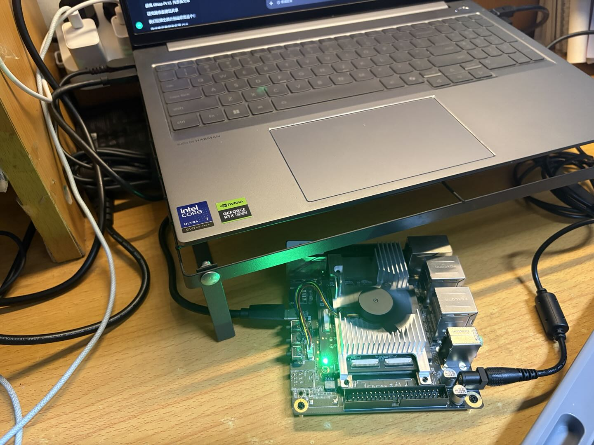
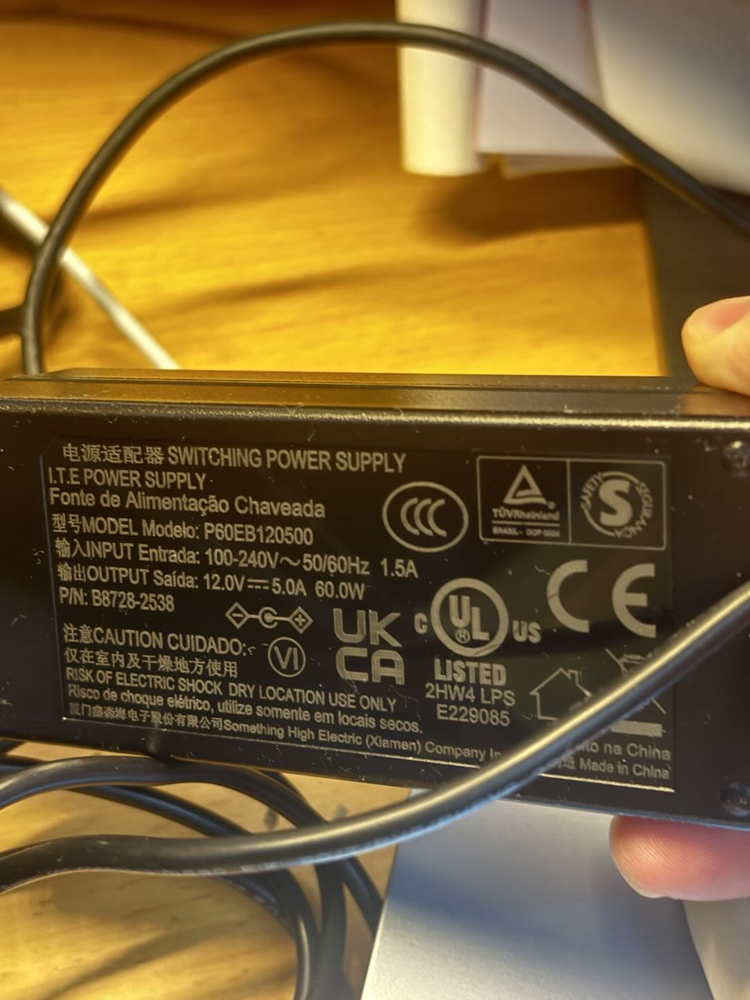
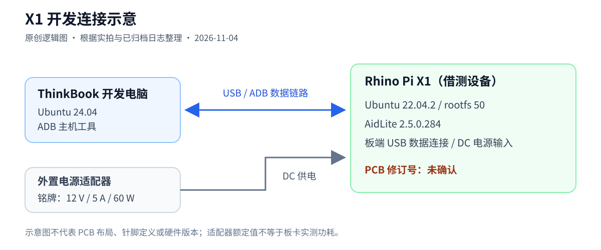

# 犀牛派 X1 上手实测：一块高通 AI 开发板能为机器人做什么？

实测日期：2026 年 11 月 4 日

这块临时借来的犀牛派 X1，给我的第一个工程问题是：接上电脑之后，现有软件环境能完成哪些工作？我用 ThinkBook 通过 USB/ADB 进入系统，核对系统和 SDK，再运行板端自带的 YOLOv5 样例。CPU 配置路径完成了固定图片检测；DSP 分支最初加载失败，经过日志和设备访问追踪，在已有普通账号下也完成了 10 次推理。

这次上手得到的价值，一部分是模型结果，另一部分是部署前容易忽略的条件：系统版本、执行账号、设备节点权限，以及“能启动样例”和“验证硬件加速”之间的距离。



图 1：本次 ThinkBook 与 X1 的连接实景，由设备持有者提供并确认。图中可见开发电脑、板卡、散热结构及板端连接；部分线缆走向受到支架或其他物体遮挡，具体通道由后文的 ADB 日志共同核对。静态照片不用于判断温度、功耗或当前模型运行状态。

## 规格要和设备读数一起看

厂商资料将 X1 定位为基于 Qualcomm QCS8550 的边缘计算开发板，列出六核 CPU、Adreno 740、16 GB LPDDR5X 和 128 GB 存储。六核配置为 1×3.2 GHz、2×2.8 GHz、3×2.0 GHz；约 48 TOPS INT8 和 DC 12 V/5 A 分别是厂商标称算力与供电规格，本次没有测量 TOPS、实际功耗或 CPU 峰值频率。[厂商平台规格](https://rhinopi.docs.aidlux.com/en/rhino-x1-ubuntu/)

实际部署更需要知道操作系统看到了什么：

| 项目 | 本机读数或状态 |
|---|---|
| SoC 标识 | `QCS_KALAMAP`，soc_id 603，revision 2.0 |
| CPU | present、possible、online 均为 `0-5`，系统报告 6 核 |
| GPU 标识 | sysfs 返回 `Adreno740v2` |
| 可见内存 | MemTotal 15,550,492 KiB，约 14.83 GiB |
| 根文件系统 | 总量约 103.18 GiB，采集时可用约 90.52 GiB |
| 系统架构 | aarch64 |

六核读数与厂商的 1+2+3 配置相符。可见内存包含系统保留等因素，根文件系统只是当前挂载分区；它们不能直接用于判定物理内存或整颗存储芯片的容量。实拍已经补充散热结构、开发电脑与板端连接以及电源适配器铭牌。借测板的硬件修订号暂时无法清晰拍摄，本文保留“未确认”，不从序列号前缀推断，也不以参考图片或示意图代替版本实证。



图 2：电源适配器型号为 `P60EB120500`，铭牌标示输入 `100–240 V AC、50/60 Hz、1.5 A`，输出 `12.0 V DC、5.0 A、60.0 W`，输出规格与厂商要求的 12 V/5 A 一致。这里核对的是铭牌额定值，没有测量负载下的实际输出；60 W 不是板卡实测功耗。

从软件分工看，本次 Python、预处理和后处理由主机侧程序组织，模型执行交给 AidLite 的相应 Backend。GPU 有设备标识但没有运行推理；DSP 配置路径的结果在后文单独说明。选择 CPU、GPU 或 DSP 的参数，是验证链的起点，实际执行设备还需要运行证据。

## USB 接入：先确认系统暴露了什么接口

这次起初没有配置 SSH。USB-C 数据线连接后，ThinkBook 识别到 Qualcomm USB 设备，描述符包含 `ADB Interface`，没有同时出现 USB 网卡或串口。因此首次接入采用 ADB。

主机安装工具时遇到过软件源 HTTPS 握手错误。最后从 Ubuntu 官方归档获取同版本的 7 个包，与本地 APT 索引中的 SHA-256 逐项核对后安装，保留了既有软件源。拔插后，`adb devices -l` 显示设备处于 `device` 状态。实际使用的 ADB 包版本为 `1:34.0.4-1build3`。

厂商提供的首次接入说明也包含 USB 与 `adb shell` 入口。本文的连接结果来自实际 ThinkBook 环境；文档中的特定电脑平台与线缆描述不作为本机连线的替代证明。[官方 ADB 登录说明](https://rhinopi.docs.aidlux.com/en/rhino-x1-ubuntu/getting-started/quick-start/quickstart_adb)



图 3：根据本次实拍和已归档日志整理的原创连接示意。蓝线表示 USB/ADB 数据链路，灰线表示外置 DC 供电；图中不表示 PCB 布局、针脚位置或硬件修订号。SVG 和 Mermaid 源文件随本文保存，便于排版使用。

连接实景用于说明搭建方式，ADB 枚举和 shell 日志用于确认通道可用；照片中被遮挡的部分不补写为已核实的主机端口类型。

以下是 ThinkBook 终端中的只读摸底命令。`X1_SERIAL` 取自自己的设备列表，多设备连接时应明确目标：

```bash
adb devices -l
export X1_SERIAL='<本机设备列表中的序列号>'
adb -s "$X1_SERIAL" shell id
adb -s "$X1_SERIAL" shell cat /etc/os-release
adb -s "$X1_SERIAL" shell uname -a
adb -s "$X1_SERIAL" shell cat /sys/devices/system/cpu/online
```

ADB shell 实际为 uid=2000、用户 `adb`。这个身份足以读取环境并运行 CPU 样例，但它的设备访问范围与另一个普通账号不同，后来直接影响了 DSP 样例的加载。

## Ubuntu 用户空间之外，还要记录内核与依赖

本机 `/etc/os-release` 报告 Ubuntu 22.04.2 LTS，包含 `AIDLUX_EDITION=linux` 和 `ROOTFS_VERSION=50`；内核为 `5.15.148-android13-8-g46a318bb187f-dirty`。这两项分别描述用户空间和内核，部署记录需要同时保留。

| 软件项 | 已取得的证据 |
|---|---|
| Python | 3.10.12 |
| pyaidlite | 包元数据 2.5.0.284；运行时 C/Python 版本均打印 `V2.5.0.284_5521ce6_20260810` |
| 推理样例 | 已有 ONNX、TFLite、QNN248 相关目录、模型和固定图片 |
| QNN 相关资产 | `qnn236`、`qnn240`、`qnn248` 目录及部分运行库；完整 SDK 尚未确认 |
| ROS | 存在 `/opt/ros/humble` 目录，本次未运行 ROS |
| SSH | OpenSSH Server 已安装，22 端口监听；尚未完成 SSH 登录实测 |

目录名适合用来找线索，不能替代工具链身份。比如 PATH 没有发现 `qnn-net-run`，既不足以确认完整 SDK 可用，也不能断言设备全盘都没有安装它。

对已有 Ubuntu 24.04/Jazzy 项目的开发者，这份镜像还意味着 Python ABI、发行版和依赖存在差异。跨平台部署应单独建立环境记录，不直接复制主机虚拟环境。

## SSH 具备服务线索，远程开发仍有待补证

网络快照中 `br-lan` 为 `192.168.1.1/24`，Wi-Fi 接口处于 DOWN；ThinkBook 的既有以太网连接在另一个网段。本次保留网络配置，通过 ADB 完成工作。

因此本文能够证明的是 USB/ADB 远程操作成功、SSH 服务已监听，尚不能写“SSH 开发已经跑通”。后续确认实际网络连接和账户后，可按厂商的 [SSH 登录说明](https://rhinopi.docs.aidlux.com/en/rhino-x1-ubuntu/getting-started/system-use/ssh)另做登录验证。

## 现成样例跑出了什么结果

第一条完成的路径是 YOLOv5 ONNX CPU 配置：模型加载成功，10 次 invoke 和结果图齐全，图片标出了 3 个人与 1 辆公交车。随后同一 TFLite 模型的 CPU 对照也完成 10 次调用，并记录了 XNNPACK CPU delegate 创建日志。

DSP 分支最初在 ADB 身份下报 HTP delegate 图应用错误 110031。一次受控 strace 捕获到 FastRPC 设备节点的实际访问拒绝；进一步核对发现，已有 `aidlux` 账号在 `system` 组，ADB 身份不在。使用该普通账号后，同一冻结模型、图片、脚本和库的 DSP 配置完成了加载、10 次 invoke 与结果图，invoke 报告均值约 1.56 ms。过程中没有改设备节点权限或 SDK。

这说明本次镜像下已有可工作的普通账号执行路径。它还没有覆盖逐节点硬件 profiling、持续负载和独立精度验收；1.56 ms 只是样例 invoke 区间的观察值。命令准备见[复现说明](reproduce.md)，运行状态与计时范围见[结果记录](results.md)。

## 放进机器人系统，适合先验证哪一层

根据本次环境与样例结果，我会优先把 X1 作为感知或推理节点的候选：接收观察，运行模型，再向 Runtime 提供带模型身份和时间信息的输出。这是基于已有证据的工程判断，仍需针对实际任务验证。

| 候选工作 | 本次基础 | 尚需建立的证据 |
|---|---|---|
| 固定图片对象检测 | CPU 与普通账号 DSP 配置样例完成 | 独立精度验证、硬件执行覆盖 |
| 机器人视觉感知节点 | 已有模型与图像处理环境 | 相机采集、时间戳、持续负载与通信 |
| 策略模型推理节点 | 已有平台接入和通用样例经验 | ACT 图兼容、转换、数值与 Runtime 接口 |

一个对象检测结果不能证明机械臂动作安全。队列积压、动作过期、故障退出和独立安全许可仍由系统工程建立。本次没有开展机械臂控制，也没有把 Qualcomm 接入现有 L1 Runtime。

实测字段和原始记录入口见 [公开证据摘要](../evidence/README.md)。本系列的下一篇沿这次 DSP 加载失败展开，说明如何把平台访问条件追到可复核的日志，再完成一次有界对照。


复现代码、环境清单和结果摘要已开源：[rhino-pi-x1-q0](https://github.com/fwr6926996-commits/rhino-pi-x1-q0)。
